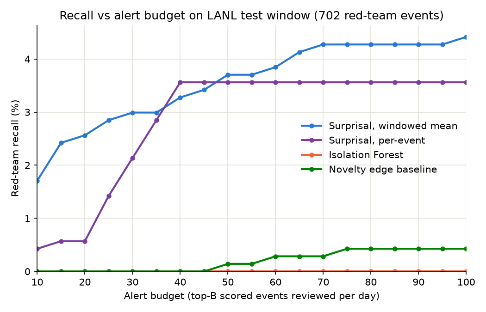

# telltail

[](LICENSE)


> Status: work in progress (v0.1-dev). This is a personal research sandbox and
> prototype, not a finished or production tool. All results are preliminary,
> from a single dataset, and a correctness and reproducibility review is
> ongoing. See [Status](#status).

A sandbox for evaluating physics-based anomaly metrics on behavioral event
streams, with authentication logs as the first application.

`telltail` builds a smoothed per-user surprisal model, then varies how that
surprisal is aggregated over a trailing window. Each candidate is a
statistical-physics observable: the mean, free energy at a tunable temperature,
variance (heat capacity), edge diversity. An empirical large-deviation rate
function was scoped and deferred (see Findings). The pipeline fits every metric
on the same per-user baseline to compare performance.

For each metric, we address its performance in terms of measurable properties
of the dataset. On the LANL authentication stream, every tail-weighted
alternative underperformed compared to the plain window mean. Two traits of the
LANL dataset, a fat benign novelty tail and a sustained multi-event attack,
explain why tail-weighted approaches performed poorly. We use our findings to
predict which observable is expected to perform well on a dataset with opposite
traits. See Findings.

At this time, LANL is the only dataset. Planned datasets include
CSE-CIC-IDS2018, UNSW-NB15, CTU-13, and ToN_IoT. The metrics and the
fit/score/evaluate pipeline are dataset-agnostic.

## Threat model

Currently, `telltail` targets credential-based lateral movement. The attacker
has valid credentials, such as phished passwords, dumped hashes, or stolen
Kerberos tickets, and uses normal authentication protocols to move from host to
host. Individual logins may look legitimate in isolation.

The sandbox assumes a centrally collected authentication stream that is
overwhelmingly benign, with red-team or malicious activity as a small minority.
The signal is account-level behavioral change, such as new destinations,
unfamiliar auth types, unusual access bursts, or other deviations from the
user's learned baseline.

## Surprisal scoring

`telltail` borrows the language of statistical physics. Writing a probability
in Boltzmann form, `p(x) = exp(-E(x)) / Z`, makes an event's surprisal
`-log p(x)` an energy-like score up to the constant `log Z`. Common behavior is
low energy, unexpected behavior is high.

The model itself measures per-user destination and auth-type frequencies,
smoothed toward population frequencies (Jelinek-Mercer backoff). These
frequencies are fit on a training window and used to score new authentications
against that user's own baseline. The physics framing guides which window
statistics to try. Per-user scoring avoids treating all rare events as equally
suspicious.

Each account is ranked by its mean standardized surprisal over a trailing
per-user window. A simple sum tracks login volume and flags the busiest
accounts. The mean instead alerts only when recent activity is consistently
unexpected, as in lateral movement. A routine account averages back to its own
baseline regardless of how much it logs in.

## Requirements

- Python 3.11+
- Core stack: polars (data pipeline), scikit-learn, matplotlib
- ~70 GB free disk for the uncompressed LANL auth stream, plus space for
  derived slices
- 8 GB+ RAM recommended

## Quickstart

```sh
git clone https://github.com/alamda/telltail.git
cd telltail

make setup      # create python venv and install pinned dependencies
# fetch the LANL auth stream into data/lanl/ first (see Data), then:
make data       # subset auth.txt into labeled slices under data/lanl/derived/
make baselines  # novelty + Isolation Forest + surprisal -> outputs/*_alerts.csv
make eval       # recall@budget table per method
make plots      # recall-vs-budget figure -> outputs/recall_vs_budget.png
```

`make help` lists all targets.

## Repo layout

```text
telltail/
├── src/         # parsing, models, scoring, evaluation
├── tests/       # pytest unit tests
├── docs/        # figures used in this README
├── data/        # raw + derived datasets (gitignored)
├── outputs/     # results tables, figures (gitignored)
└── Makefile
```

## Status

v0.1-dev is a research prototype. Metrics, the per-user surprisal model, and the
evaluation pipeline are implemented and run on the LANL authentication stream
(see Results and Findings), with a unified detect CLI (`src/detect.py`) and the
recall-vs-budget plot. LANL is the only dataset connected so far.

See Backlog for the research roadmap.

## Results (LANL Dataset)

We measure the recall at a fixed per-day alert budget on the LANL test window.
Recall is the fraction of the 702 test-window red-team events caught inside
each day's top-B scored events. Denominator and split are fixed across methods
(train/test split at the first red-team event, time 150885).

Data subset: `data/lanl/derived/compromised_users.csv`, the full auth history
restricted to users named in `data/lanl/redteam.txt` (19.7M events). Restricting
to flagged users inflates recall. A full-stream run over `data/lanl/auth.txt`
(1.05B events) is planned once the prototype is more developed.

| Recall @ B alerts/day    | B=10  | B=25  | B=50  | B=100 |
| ------------------------ | ----- | ----- | ----- | ----- |
| Novelty edge baseline    | 0%    | 0%    | 0.14% | 0.43% |
| Isolation Forest         | 0%    | 0%    | 0%    | 0%    |
| Surprisal, per-event     | 0.43% | 1.42% | 3.56% | 3.56% |
| Surprisal, windowed mean | 1.71% | 2.85% | 3.70% | 4.42% |

The windowed mean is telltail's default scoring method.

Absolute recall is low. Labels are sparse and red-team events are rare, but the
relative gap over both baselines holds across every budget.



Each method writes its scored alerts to `outputs/*_alerts.csv`. The table is
generated by `src/evaluate.py` from those files, and the plot by `src/plots.py`
(`make plots`). Not yet wired: no `make` target writes the windowed-mean alerts
(`outputs/surprisal_mean_alerts.csv`) that the plot and the last table row
need. `make sweep` does reproduce the windowed-mean numbers.

## Findings

The windowed mean is the default because it scored best of all measures tested
so far. Each observable below aggregates the same per-user
standardized surprisal `z` over the trailing window, changing only how the
window is summarized. Recall is red-team events caught at 50 alerts per day,
out of 702.

| Window observable                       | Physics analog | Recall @ B=50 | Why it loses |
| --------------------------------------- | -------------- | ------------- | ------------ |
| Mean (default)                          | -              | 26            | -            |
| Free energy `G_T = T log mean e^{z/T}`  | temperature    | 18            | interpolates between the mean and the max, so lowering `T` weights the fat benign novelty tail more heavily; at `T=8` it trails the mean, and by `T=16` it is back within one event of it |
| Variance                                | heat capacity  | 3             | rewards inconsistency, but a sustained lateral-movement run is uniformly high `z`, i.e. low variance |
| Distinct-edge count                     | -              | 0             | ranks account busyness, not deviation; the per-user standardization already normalizes each account against its own baseline diversity |

The consolidated sweep across every method tried, as red-team events caught out
of 702 at each budget. `alerts_used` is set by the budget alone (570 / 1425 /
2850 / 5700 at B=10 / 25 / 50 / 100, i.e. B per day over the 57 test days), so it
is the same for every row and false positives are `alerts_used - caught`. Every
row is regenerated by `make sweep`.

| Method                         | Standardization | B=10 | B=25 | B=50 | B=100 |
| ------------------------------ | --------------- | ---- | ---- | ---- | ----- |
| Isolation Forest (baseline)    | -               |  0   |  0   |  0   |   0   |
| Novelty edges (baseline)       | -               |  0   |  0   |  1   |   3   |
| Free energy `G_T`, T=8         | mad             | 11   |  18  |  18  |  21   |
| Window variance                | mad             |  0   |  1   |  3   |   5   |
| Distinct-edge count            | mad             |  0   |  0   |  0   |   0   |
| Per-event z                    | mad             |  3   |  10  |  25  |  25   |
| Per-event z                    | meanstd         |  4   |  11  |  35  |  41   |
| Per-event z                    | logz            |  4   |   9  |  34  |  38   |
| Window mean (default)          | mad             | 12   |  20  |  26  |  31   |
| Window mean                    | meanstd         | 12   |  18  |  26  |  31   |
| Window mean                    | logz            | 11   |  17  |  21  |  29   |

The standardization column is how the per-user surprisal is centered / scaled
before windowing:
- `mad`: median / MAD, the default
- `meanstd`: mean / std
- `logz`: per-user entropy / sqrt(per-user heat capacity), calculated from the
  partition function

A better per-event scale (meanstd, logz) separates red team at the event level:
per-event recall climbs from 25 to 34-41 at B=50-100. The window mean averages
that gain back out.

The free-energy row is quoted at `T=8`. Sweeping `T` over 0.5 / 1 / 2 / 4 / 8 /
16 / 32 / 64 gives 2 / 2 / 2 / 6 / 18 / 27 / 24 / 25 caught at B=50, against the
window mean's 26. `G_T` interpolates the mean to the max by construction, so the
low-`T` end carries the finding: weighting the tail costs recall on this
dataset. The high-`T` end recovers the mean and no temperature beats it by more
than one event.

Two dataset traits are responsible for poor performance of tail-weighted
methods:

1. a fat benign novelty tail, from a large enterprise with many first-time host
   pairs;
2. an attack that is a sustained multi-event campaign rather than a single spike.

The mean is robust to the first and matched to the second. The measures that
underperform on the LANL dataset are expected to win on other threat models,
such as low-temperature free energy on one-shot attacks with a clean
benign tail, or variance on genuine regime-change (account takeover, insider
turning bursty).

The large-deviation program was gated on a separate measurement: does a
trailing window ever hold enough independent events for a rate function to be
meaningful? Raw window counts can appear large (median around 7,000 events at
one hour), but that is inflated by high-volume accounts replaying a few host
pairs. The effective sample size, the participation ratio
`n_eff = n^2 / sum_i c_i^2` over distinct edges, plateaus in the low teens and
does not grow when the window widens. Specifically, a red-team window's raw
count grows 14x from a 1-hour to a 24-hour window while its `n_eff` grows only
1.5x. There is no `n`-large regime here, so the empirical rate function and
the cloning / population-dynamics track are deferred until other datasets can
be tested.

## Reproducibility

- Train / test split: first red-team event, time 150885 (same as Results).
  `--split-fraction` moves the split for experiments; reported numbers use
  the default.
- Pinned environment: `requirements.txt`

## Data

[LANL "Comprehensive, Multi-Source Cyber-Security Events"](https://csr.lanl.gov/data/cyber1/)
(Kent, 2015). Authentication events are the input stream. `redteam.txt` provides
ground-truth labels for red team activity.

The dataset is not redistributed here. Fetch the two files `telltail` uses
directly from LANL and decompress them into `data/lanl/`:

```sh
mkdir -p data/lanl && cd data/lanl
curl -O https://csr.lanl.gov/data/cyber1/auth.txt.gz     # ~10.7 GB gzipped, ~70 GB uncompressed
curl -O https://csr.lanl.gov/data/cyber1/redteam.txt.gz  # ~5 KB gzipped, ~23 KB uncompressed
gunzip auth.txt.gz redteam.txt.gz
```

`make data` then reads `data/lanl/auth.txt` and `data/lanl/redteam.txt` in a
single pass (`src/make_subsets.py`) and writes the labeled subsets under
`data/lanl/derived/`. The full scoring pipeline runs on
`data/lanl/derived/compromised_users.csv` (19.7M events).

## Method

1. Baselines
    * novelty detection (unseen `(src_comp, dst_comp, auth_type)` edges)
        - tier 0: `(dst_comp, auth_type)` also unseen in train (host meets new
          protocol); subset of triple-novel events, ranks higher
        - tier 1: only the src_comp is new for a known `(dst_comp, auth_type)`
    * an Isolation Forest over auth/logon features
2. Surprisal model
    * fit a per-user distribution over destinations and auth types from a
      training window
    * score test events by surprisal
    * standardize each user's surprisal against their own training
      distribution (median / MAD by default)
    * aggregate standardized surprisal `z` over a trailing 1-hour per-user
      window (mean by default; free energy, variance, distinct edges compared
      in Findings)
3. Evaluation
    * recall at a fixed daily alert budget (e.g. top 50 alerts/day)

## Backlog

- [ ] Burstiness of novel edges (interevent times of high-`z` events):
      window statistic orthogonal to the edge model and the per-user
      standardization; characterizes how lateral movement clusters in time
- [ ] Full-stream evaluation: score every event in `auth.txt`
- [ ] Fuse proc, flow, and DNS sources for multi-signal detection
- [ ] Build the authentication graph and score edges as a graph anomaly problem
- [ ] Near-real-time sliding-window replay
- [ ] Additional datasets: CSE-CIC-IDS2018, UNSW-NB15, CTU-13, and ToN_IoT.

## Limitations and non-goals

- Single dataset wired up (LANL cyber1). The premise is cross-dataset
  comparison, so metric performance conclusions are provisional until more
  datasets are connected. Findings are stated as dataset-property predictions
  so that the next dataset can test them.
- No validation split yet. Method and parameter choices were made on the
  reported test window, so the reported absolute numbers are optimistic.
- Currently offline batch scoring, not a real-time production detector.
- Auth stream only for now; proc/flow/DNS fusion is backlog.
- Ground truth is the LANL red-team labels. Benign anomalies will still alert.

## Citation

A DOI will be minted through Zenodo when the first release (`v0.1`) is tagged.
Until then cite the repository directly.

```bibtex
@misc{telltail,
  author = {Alexandra Lamtyugina},
  title  = {telltail: a sandbox for physics-based anomaly metrics on event streams},
  year   = {2026},
  url    = {https://github.com/alamda/telltail}
}
```

Dataset:

```bibtex
@Misc{kent-2015-cyberdata1,
  author       = {Alexander D. Kent},
  title        = {{Comprehensive, Multi-Source Cyber-Security Events}},
  year         = {2015},
  howpublished = {Los Alamos National Laboratory},
  doi          = {10.17021/1179829}
}
```

## Contributing

This is a research prototype and the internal APIs are unstable before `v0.1`.
Bug reports and questions are welcome as GitHub issues. Please open an issue to
discuss before sending a pull request.

## Contact

Open an issue at <https://github.com/alamda/telltail/issues>.

## License

Apache License 2.0. See [LICENSE](LICENSE).
